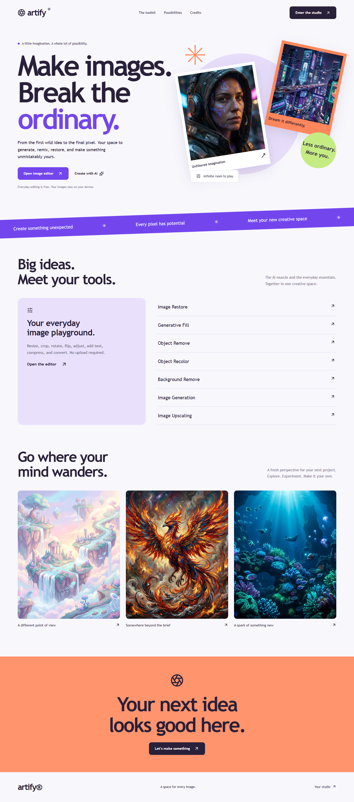
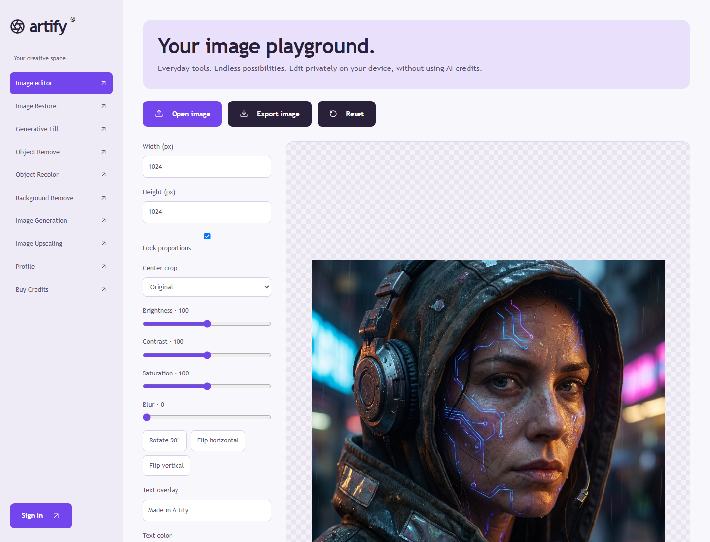
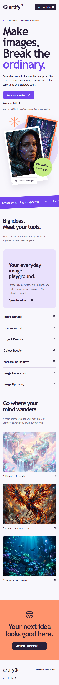
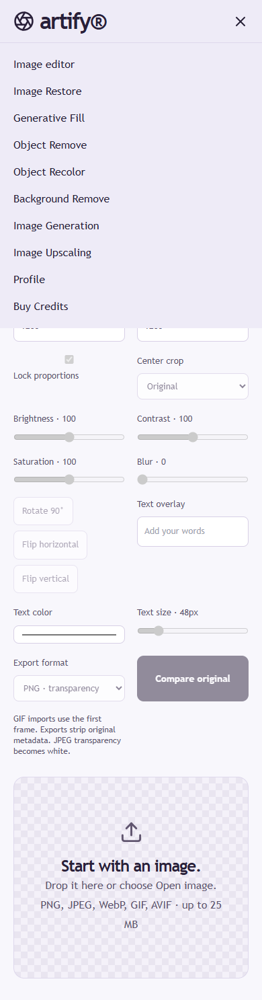

# Artify

A creative workspace for AI image transformations and private, everyday image editing. Built with Next.js 15, React 19, TypeScript, Tailwind CSS, Clerk, MongoDB, Cloudinary, Gemini, and Stripe.

## Screenshots

Real browser captures of the public pages. The editor example uses an artwork included in this repository; authenticated pages are not represented by fabricated screenshots.

### Landing page



### Image editor



### Mobile





## Run locally

```sh
npm ci
npm run dev
```

Open http://localhost:3000/landingPage. The default development command uses Turbopack. For environments where its worker processes cannot start, use `npx next dev`.

For a production preview:

```sh
npm run build
npm run start
```

For another port, invoke Next directly: `node node_modules/next/dist/bin/next start -p 3010`.

## Configuration

Create an untracked `.env.local` with values from your own service accounts. Never commit keys or expose provider secrets through `NEXT_PUBLIC_` variables.

- `NEXT_PUBLIC_SERVER_URL`: the application origin, including port for local development. Used for checkout return links.
- `NEXT_PUBLIC_CLERK_PUBLISHABLE_KEY`, `CLERK_SECRET_KEY`: Clerk authentication.
- `NEXT_PUBLIC_CLERK_SIGN_IN_URL=/sign-in`, `NEXT_PUBLIC_CLERK_SIGN_UP_URL=/sign-up`: authentication routes. Configure Clerk's allowed origins and redirect settings for your deployment.
- `WEBHOOK_SECRET`: Clerk webhook signing secret for `/api/webhooks/clerk`.
- `MONGODB_URL`: MongoDB connection string. The application uses the `Artify` database.
- `NEXT_PUBLIC_CLOUDINARY_CLOUD_NAME`, `CLOUDINARY_API_KEY`, `CLOUDINARY_API_SECRET`: Cloudinary uploads, image delivery, transformations, and asset lookup. Configure the `ali_artify` upload preset used by the upload widget. Update `next.config.ts` if using a different Cloudinary image-delivery account.
- `GEMINI_API_KEY`: server-side Gemini image generation. Optional `GEMINI_IMAGE_MODEL` defaults to `gemini-2.5-flash-image`.
- `STRIPE_SECRET_KEY`, `STRIPE_WEBHOOK_SECRET`: checkout and verified credit fulfillment. Register `/api/webhooks/stripe` for `checkout.session.completed` and `checkout.session.async_payment_succeeded`.

The local image editor does not upload files or consume credits. The application shell still uses Clerk, so configure authentication even when previewing the public editor.

## Pages and features

### Public pages

- `/landingPage` — Artify introduction, image collage, AI tool directory, artwork gallery, editor entry points, sign-in entry, and links to credits. Responsive desktop and mobile layouts.
- `/studio` — Local image editor. Open or drag in PNG, JPEG, WebP, GIF, or AVIF files up to 25 MB and 40 megapixels. Resize with optional proportion locking; center-crop to original, square, portrait, or landscape; rotate in 90-degree steps; flip horizontally or vertically; adjust brightness, contrast, saturation, and blur; add text with color and size controls; compare with the original; reset; and export PNG, JPEG, or WebP with JPEG/WebP quality controls. Home is omitted from the editor's desktop sidebar and mobile menu.
- `/sign-in/[[...sign-in]]` — Clerk-hosted sign-in interface and nested authentication steps. Methods depend on the Clerk account configuration.
- `/sign-up/[[...sign-up]]` — Clerk-hosted registration and nested verification steps. New application users receive the configured initial balance of 10 credits.
- Unmatched routes — A custom 404 screen with a link back to the application. Authentication middleware may redirect signed-out visitors before protected routes render.

### Signed-in workspace

- `/` — Tool directory, direct access to the local editor, recent shared image collection, search, pagination, and image previews. Signed-out visitors are redirected to `/landingPage`. The collection is shared across users; the profile contains the current user's saved images.
- `/transformations/add/restore` — Upload an image, enter a title, apply AI restoration, preview/download the output, and save the transformation to the library.
- `/transformations/add/fill` — Upload an image, choose a target aspect ratio, apply generative background fill/outpainting, preview/download, and save.
- `/transformations/add/remove` — Describe objects to remove from an uploaded image, apply removal, preview/download, and save.
- `/transformations/add/recolor` — Describe the object and target color, apply recoloring, preview/download, and save.
- `/transformations/add/removeBackground` — Upload an image, remove its background using AI, preview/download the cutout, and save.
- `/transformations/add/upscale` — Upload an image, apply Cloudinary's AI upscale effect, preview/download, and save. Availability and output constraints depend on Cloudinary.
- `/transformations/add/generation` — Generate an image from a text prompt and square, portrait, or story aspect ratio. Requires a Gemini API key and at least one credit. A credit is reserved atomically before generation and returned on provider failure. Download the result before leaving; generated images are not automatically saved in the library.
- `/transformations/add/video` — Explicit unavailable-state screen with a link to image generation. Video generation is not implemented and is omitted from navigation.
- `/transformations/[id]` — View a saved image, transformation type, available prompt/color/aspect details, original image, transformed preview, and download. Owners can open the update page or delete their saved record.
- `/transformations/[id]/update` — Reopen a saved transformation's title, upload, settings, and preview; apply changes and save the updated record. Server actions enforce ownership for updates.
- `/profile` — Available credit balance, a count of images on the current collection page, and the current user's paginated saved-image collection.
- `/credits` — Free, Pro, and Premium credit packages with prices and included credits. Paid packages open Stripe Checkout. Prices and buyer identity are determined on the server; successful signed payments grant credits once per checkout session.

### Supporting endpoints

- `POST /api/webhooks/clerk` — Verifies Clerk webhook signatures and synchronizes user records.
- `POST /api/webhooks/stripe` — Verifies Stripe signatures, checks paid status, currency, and package amount, and atomically grants credits with duplicate-delivery protection. Delayed payment success is supported.
- `GET /api/dbcheck` — Authenticated database diagnostic that pings MongoDB and performs a temporary write/read/delete round trip. This is a diagnostic endpoint, not a product page.

## Limitations and verification

- AI transformations need Cloudinary credentials, an upload preset, and enabled provider capabilities. Live AI calls and real payment flows require separate service-account testing.
- Gemini generation is unavailable until `GEMINI_API_KEY` is configured. Generated results are temporary page state until downloaded.
- The editor exports static images. GIF imports use the first frame, original metadata is not preserved, and JPEG exports replace transparency with white. Output dimensions are limited to 4096 pixels per side.
- The editor has reset and original comparison, but no edit-history undo/redo or batch processing.
- Credit consumption for existing Cloudinary transformations occurs when applying a transformation; provider-side failures do not currently trigger an automatic refund. Gemini failures do.
- Credit packages are one-time purchases, not subscriptions. Connect the Stripe webhook before enabling checkout in production, and verify with Stripe test credentials.

Run validation:

```sh
npx tsc --noEmit
npm run test:smoke
npm run build
```

The smoke checks cover duplicate/unpaid checkout handling, invalid checkout amounts, first-transformation initialization, and nested configuration merging. Browser capture checks additionally exercise image loading, text overlay, format export, and the editor's desktop/mobile navigation.

## Screenshot reproduction

`scripts/capture-website.py` uses Python Playwright and an installed Chrome browser. Install Playwright in a separate Python environment, start the production preview on port 3010, and run the script from the repository root. Set `ARTIFY_PREVIEW_URL` or `ARTIFY_CHROME_PATH` to override its defaults. The script saves screenshots under `docs/screenshots/` and does not sign in, generate paid AI images, or make purchases.
